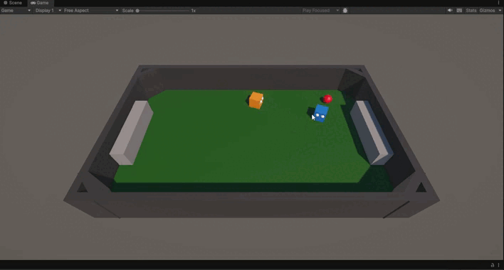
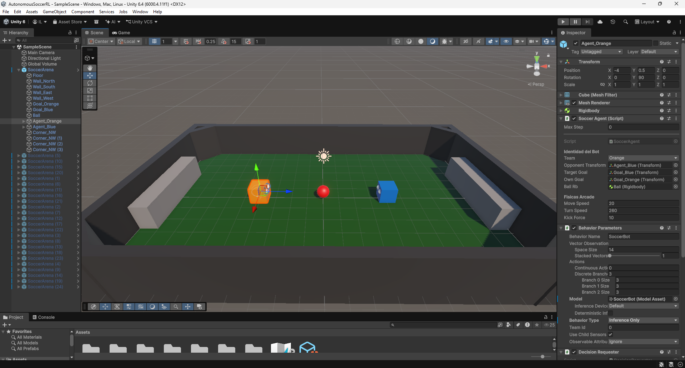
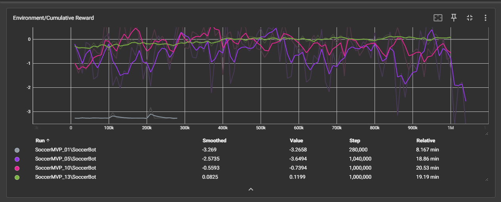
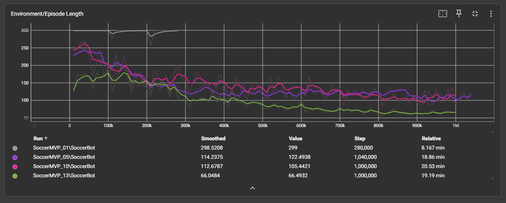
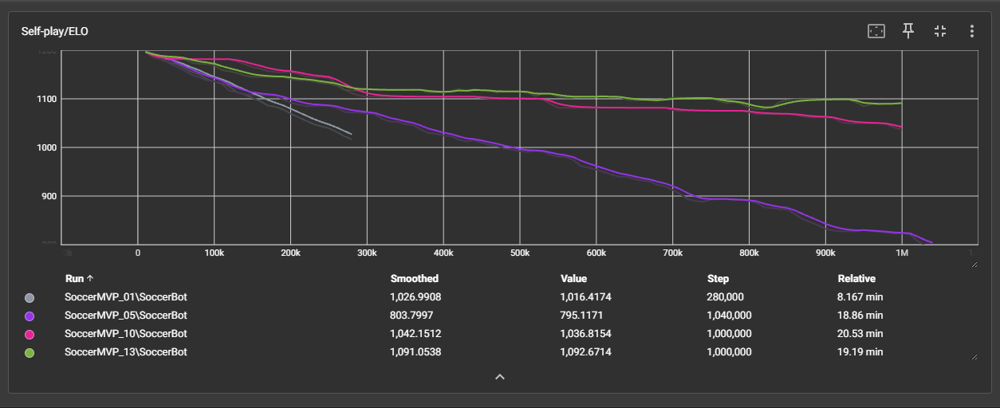

# ⚽ Autonomous 1v1 Soccer Agents via Deep Reinforcement Learning (PPO & Self-Play)

🌐 **Language / Idioma:** [English](#-english) | [Español](#-español)

---

## 🇬🇧 English

[-black?style=for-the-badge&logo=unity)]([https://unity.com/](https://unity.com/))
[](https://github.com/Unity-Technologies/ml-agents)
[](https://pytorch.org/)
[](https://www.python.org/)

Competitive multi-agent **Deep Reinforcement Learning (DRL)** environment built in **Unity 6 LTS** and **Python**. Autonomous agents learn to play 1v1 arcade soccer under continuous rigid-body physics using **Proximal Policy Optimization (PPO)** and **Self-Play**—developing ball control, defensive goal-line clearances, and shot alignment without scripted heuristics or behavior trees.



*Figure 1: Trained ONNX model (`SoccerBot.onnx`) running in real-time (`time_scale = 1`) in Inference Only mode.*

---

### ⚙️ Environment Setup & Hyperparameters (YAML)

Trained across **25 parallel arenas** (**50 simultaneous agents**) at `time_scale = 20` on local hardware (AMD Ryzen 7 3700X + NVIDIA RTX 4060 CUDA), reaching **1,000,000 steps in 19m 19s**. Parameters configured in `soccer_config.yaml`:

| Hyperparameter | Configured Value | Technical Rationale |
| :--- | :--- | :--- |
| **Trainer / Network** | `PPO` / MLP (`2 × 256`) | Two-layer neural network with automatic input observation normalization. |
| **Batch Size** | `2048` | Stabilizes policy gradient updates across 50 parallel agents. |
| **Buffer Size** | `20480` | Collects 10 full mini-batches of multi-agent transitions per update cycle. |
| **Learning Rate** | `0.0003` (Linear Decay) | Smooth step-size annealing to prevent late-stage policy oscillation. |
| **Epsilon (PPO Clip)** | `0.2` | Bounds policy ratio updates to prevent catastrophic performance collapse. |
| **Gamma (Discount Factor)** | `0.99` | Prioritizes long-horizon multi-step plays leading to goals. |
| **Self-Play Schedule** | `save: 25k` / `swap: 50k` | Trains against the latest policy 70% of the time (`initial_elo = 1200`). |

---

### 📐 Arena Physics & Egocentric Agent Architecture



*Figure 2: `20 × 12` zero-friction arena featuring `45°` chamfered corners and `CapsuleCollider` agents with `+Z` forward indicators.*

* **Arena Geometry (`SoccerArena`):** `20 × 12` Unity-unit closed pitch with zero-friction floor, `45°` chamfered corner blocks to prevent dead-ball corner traps, trigger-based goal detectors (`GoalDetector.cs`), and `Continuous Dynamic` collision detection on the ball Rigidbody to prevent wall tunneling.
* **Egocentric Observation Space (14 Continuous Variables):** All world coordinates are projected into each agent's local frame via `InverseTransformPoint` and `InverseTransformDirection`, allowing both teams to share a single policy network:
  * Relative ball position (X, Z) and velocity (X, Z) (4 variables).
  * Agent own local velocity (X, Z) (2 variables).
  * Relative opponent goal and own goal positions (X, Z) (4 variables).
  * Relative opponent position (X, Z) and directional team compass vector (4 variables).
* **Discrete Action Space (3 \times 3 \times 3 = 27 Combinations):** Replaces jitter-prone continuous outputs with 3 independent discrete branches:
  * **Branch 0 (Longitudinal):** `0` Idle, `1` Forward (`moveSpeed = 20`), `2` Reverse (`70%` speed).
  * **Branch 1 (Lateral Strafe):** `0` None, `1` Strafe Right, `2` Strafe Left.
  * **Branch 2 (Yaw Rotation):** `0` None, `1` Turn Right (`turnSpeed = 260°/s`), `2` Turn Left.
* **Sparse Reward Function (R):** Eliminates dense reward-shaping traps observed in early runs (`Runs 01–12`):
  R = R_{\text{goal}} + R_{\text{concede}} + R_{\text{step}}
  * R_{\text{goal}} = +1.0 + 0.5 \cdot \left(1 - \frac{t}{T_{\max}}\right) upon scoring (speed bonus up to +1.5).
  * R_{\text{concede}} = -1.0 upon conceding a goal.
  * R_{\text{step}} = -0.0005 per step to incentivize direct offensive play.

---

### 📊 Telemetry & Quantitative Analysis (TensorBoard)

Iterative refinement across **13 experimental runs** comparing baseline dense shaping (`SoccerMVP_01`) against the final discrete-egocentric architecture (`SoccerMVP_13`):

| Metric | `SoccerMVP_01` (Baseline) | `SoccerMVP_13` (Final) | Technical Interpretation |
| :--- | :---: | :---: | :--- |
| **Cumulative Reward** | -3.27 | **+0.120** *(peak +0.247)* | Escaped local minima and achieved net positive scoring efficiency. |
| **Mean Episode Length** | 299.0 steps *(timeout)* | **66.49 steps** | **77.9% reduction** in match duration via fast, decisive attacks. |
| **Self-Play ELO** | 1016.42 *(declining)* | **1092.67** *(stable)* | Balanced offensive and defensive co-evolution without policy collapse. |

### 📈 Convergence Plots


*Figure 3: `Environment/Cumulative Reward` crossing into positive territory after 310k steps in `SoccerMVP_13`.*


*Figure 4: `Environment/Episode Length` dropping from 299-step timeouts to 66.49 steps per goal.*


*Figure 5: `Self-play/ELO` demonstrating competitive equilibrium across 1,000,000 training steps.*

---

### 📦 Local Setup & Training

```bash
# 1. Clone repository
git clone https://github.com/MarketablePlushiee/AutonomousSoccerRL.git
cd AutonomousSoccerRL

# 2. Create virtual environment & install dependencies
python -m venv venv
venv\Scripts\activate
pip install mlagents==1.1.0 torch

# 3. Start multi-agent training (press Play in Unity Editor when prompted)
mlagents-learn soccer_config.yaml --run-id=SoccerMVP_13
```

### 👨‍💻 Author & Contact

* **Iván Latrille Brito** — [ivan.latrille1@gmail.com](mailto:ivan.latrille1@gmail.com)
* **Portfolio:** [marketableplushiee.github.io/Portafolio](https://marketableplushiee.github.io/Portafolio/)

---
---

## 🇪🇸 Español

[-black?style=for-the-badge&logo=unity)]([https://unity.com/](https://unity.com/))
[](https://github.com/Unity-Technologies/ml-agents)
[](https://pytorch.org/)
[](https://www.python.org/)

Entorno competitivo multi-agente de **Aprendizaje por Refuerzo Profundo (DRL)** desarrollado en **Unity 6 LTS** y **Python**. Los agentes autónomos aprenden a disputar partidos de fútbol 1v1 bajo física rígida continua mediante **Proximal Policy Optimization (PPO)** y auto-juego (**Self-Play**), desarrollando conducción, cobertura defensiva sobre la línea de gol y definición sin reglas heurísticas ni árboles de decisión.


*Figura 1: Modelo ONNX entrenado (`SoccerBot.onnx`) ejecutándose en tiempo real (`time_scale = 1`) en modo Inference Only.*

---

### ⚙️ Configuración del Entorno e Hiperparámetros (YAML)

Entrenado en **25 canchas paralelas** (**50 agentes simultáneos**) a `time_scale = 20` en hardware local (AMD Ryzen 7 3700X + NVIDIA RTX 4060 CUDA), completando **1.000.000 de pasos en 19 min 19 s**. Parámetros definidos en `soccer_config.yaml`:

| Hiperparámetro | Valor Configurado | Justificación Técnica |
| :--- | :--- | :--- |
| **Algoritmo / Red** | `PPO` / MLP (`2 × 256`) | Perceptrón multicapa de 2 capas ocultas con normalización automática de entradas. |
| **Batch Size** | `2048` | Estabiliza las actualizaciones de gradiente entre los 50 agentes paralelos. |
| **Buffer Size** | `20480` | Recopila 10 mini-lotes completos de transiciones antes de actualizar la política. |
| **Learning Rate** | `0.0003` (Decaimiento lineal) | Reduce progresivamente el tamaño de paso para evitar oscilaciones tardías. |
| **Epsilon (PPO Clip)** | `0.2` | Limita la magnitud de cambio de la política para prevenir colapsos de rendimiento. |
| **Gamma (Factor Descuento)** | `0.99` | Prioriza secuencias tácticas de varios pasos que culminan en gol. |
| **Self-Play** | `save: 25k` / `swap: 50k` | Enfrenta al agente contra su versión más reciente en el 70% de los partidos (`initial_elo = 1200`). |

---

### 📐 Física de la Arena y Arquitectura Egocéntrica


*Figura 2: Cancha sin fricción de `20 × 12` con esquinas achaflanadas en `45°` y agentes con `CapsuleCollider` e indicadores frontales `+Z`.*

* **Geometría de la Arena (`SoccerArena`):** Recinto cerrado de `20 × 12` unidades con suelo sin fricción, bloques en `45°` en las cuatro esquinas para evitar bloqueos del balón, detectores de gol por volumen *trigger* (`GoalDetector.cs`) y detección de colisiones `Continuous Dynamic` en el balón para evitar atravesar muros (*tunneling*).
* **Espacio de Observación Egocéntrico (14 Variables Continuas):** Todas las posiciones y velocidades se proyectan al sistema de coordenadas local de cada agente mediante `InverseTransformPoint` e `InverseTransformDirection`, permitiendo compartir una única red neuronal entre ambos equipos:
  * Posición (X, Z) y velocidad (X, Z) relativas del balón (4 variables).
  * Velocidad lineal propia (X, Z) (2 variables).
  * Posición relativa del arco rival (X, Z) y del arco propio (X, Z) (4 variables).
  * Posición relativa del adversario (X, Z) y vector brújula del eje de ataque (4 variables).
* **Espacio de Acciones Discretas (3 \times 3 \times 3 = 27 Combinaciones):** Elimina las vibraciones de las acciones continuas mediante 3 ramas discretas independientes:
  * **Rama 0 (Desplazamiento longitudinal):** `0` Detenerse, `1` Avanzar (`moveSpeed = 20`), `2` Retroceder (`70%` velocidad).
  * **Rama 1 (Desplazamiento lateral / Strafe):** `0` Ninguno, `1` Derecha, `2` Izquierda.
  * **Rama 2 (Rotación en eje Y):** `0` Ninguno, `1` Girar derecha (`turnSpeed = 260°/s`), `2` Girar izquierda.
* **Función de Recompensa Dispersa (R):** Elimina las trampas de *reward shaping* denso detectadas en las primeras iteraciones (`Runs 01–12`):
  R = R_{\text{goal}} + R_{\text{concede}} + R_{\text{step}}
  * R_{\text{goal}} = +1.0 + 0.5 \cdot \left(1 - \frac{t}{T_{\max}}\right) al anotar (bono por gol rápido hasta +1.5).
  * R_{\text{concede}} = -1.0 al recibir un gol.
  * R_{\text{step}} = -0.0005 por paso para incentivar ataques directos.

---

### 📊 Telemetría y Análisis Cuantitativo (TensorBoard)

Evolución experimental a lo largo de **13 iteraciones**, contrastando el modelo base con recompensas densas (`SoccerMVP_01`) frente a la arquitectura discreta-egocéntrica definitiva (`SoccerMVP_13`):

| Métrica | `SoccerMVP_01` (Base) | `SoccerMVP_13` (Final) | Interpretación Técnica |
| :--- | :---: | :---: | :--- |
| **Recompensa Acumulada** | -3.27 | **+0.120** *(pico +0.247)* | Supera mínimos locales y alcanza eficiencia ofensiva positiva. |
| **Duración Media Episodio** | 299.0 pasos *(empate)* | **66.49 pasos** | **Reducción del 77,9%** en duración de partido gracias a definiciones rápidas. |
| **Self-Play ELO** | 1016.42 *(en caída)* | **1092.67** *(estable)* | Co-evolución equilibrada entre ataque y defensa sin colapso de política. |

### 📈 Gráficos de Convergencia


*Figura 3: `Environment/Cumulative Reward` cruzando a valores positivos tras 310k pasos en `SoccerMVP_13`.*


*Figura 4: `Environment/Episode Length` cayendo de empates de 299 pasos a 66,49 pasos por gol.*


*Figura 5: `Self-play/ELO` demostrando estabilidad competitiva durante 1.000.000 de pasos.*

---

### 📦 Instalación y Entrenamiento Local

```bash
# 1. Clonar el repositorio
git clone https://github.com/MarketablePlushiee/AutonomousSoccerRL.git
cd AutonomousSoccerRL

# 2. Crear entorno virtual e instalar dependencias
python -m venv venv
venv\Scripts\activate
pip install mlagents==1.1.0 torch

# 3. Iniciar entrenamiento multi-agente (presionar Play en Unity cuando lo solicite)
mlagents-learn soccer_config.yaml --run-id=SoccerMVP_13
```

### 👨‍💻 Autor y Contacto

* **Iván Latrille Brito** — [ivan.latrille1@gmail.com](mailto:ivan.latrille1@gmail.com)
* **Portafolio:** [marketableplushiee.github.io/Portafolio](https://marketableplushiee.github.io/Portafolio/)
